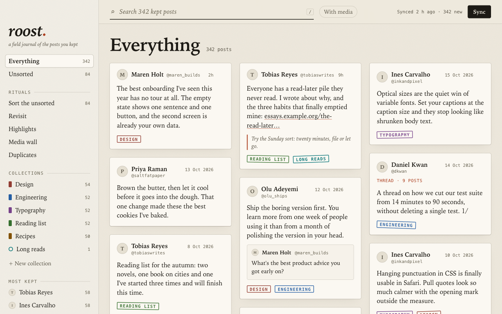

# roost

roost copies the posts you bookmark on X to your Mac and keeps them there.
You can sort them into collections, search them, and read them with their
threads, pictures and linked articles. A post stays in roost after its
author deletes it or X takes it down.

You don't need a paid X account or any setup. roost signs in to the X
website as you, and reads your bookmarks there.



## What you need

- A Mac with macOS 12 Monterey or later. Apple silicon and Intel Macs both
  work.
- An X account with some bookmarks.

## Install

1. Go to the [latest release](https://github.com/Ernxst/roost/releases/latest).
   Under **Assets**, download the file whose name ends in `.dmg`.
2. Open the downloaded file, and drag the roost icon onto the Applications
   folder in the window that appears.
3. Open roost from your Applications folder. macOS warns that it can't check
   roost for malicious software. It shows this warning because roost isn't
   registered with Apple, which costs a yearly fee. Click **Done**.
4. Open **System Settings** and choose **Privacy & Security**. Scroll down to
   the message about roost, click **Open Anyway**, and confirm with your
   password or Touch ID.

You only do this once. After that, roost opens like any other app and
installs its own updates.

## Your first sync

1. Click **Sync from X**.
2. A window shows X's sign-in page. Sign in as you normally do. roost
   remembers the sign-in, so X asks again only if it signs you out.
3. roost reads your bookmarks, newest first. Thousands of bookmarks can take a
   few minutes.

To get new bookmarks later, click **Sync** at the top of the window. To have
roost sync on its own, open **Settings** and choose how often under
**Background sync**. When you close the window, roost keeps running from its
icon in the menu bar. Settings can also turn on a notification when new
bookmarks arrive.

## Finding your way around

- **Collections** are folders for your bookmarks. Click **+ New collection**
  in the sidebar. To add a post to a collection, open the post and tick the
  collection.
- **Sort the unsorted** shows the bookmarks that aren't in a collection yet,
  one at a time. Press a number key to put each one in a collection. roost
  suggests the collections it most likely belongs in.
- **Search** finds words in posts, in the articles they link to and in your
  own notes. Add these to a search to narrow it:

  | Type | To find |
  | --- | --- |
  | `from:someone` | posts by that account |
  | `has:video` | posts with a video (or `photo`, `link`, `thread`) |
  | `in:"Reading list"` | posts in that collection |
  | `is:unopened` | posts you haven't opened in roost yet |

- **Revisit** shows posts from this date in earlier years, posts you've
  never opened, and a random handful.
- **Highlights** lists the passages you've marked in posts and articles.
- **Media wall** shows every photo and video you've kept.
- **Duplicates** finds bookmarks that share a post, a link or a picture.
- Open a post to read its whole thread, write a note on it, or read the
  article it links to.
- **Export** in Settings saves your library as Markdown notes, which
  Obsidian and most other notes apps can open.
- Press `?` to see every keyboard shortcut.

## Updates

roost checks for a new version once a day. When it finds one, a window shows
what's new and offers to restart roost with it. To check straight away, click
the roost icon in the menu bar and choose **Check for Updates…**.

## Privacy

Your bookmarks, notes and X sign-in stay on your Mac. roost connects only to
X, to the servers that hold X's pictures and videos, and to the pages your
bookmarks link to. It sends nothing anywhere else.

## If something goes wrong

- **macOS won't open roost.** Follow step 4 of Install again. The **Open
  Anyway** button stays in Privacy & Security for about an hour after the
  warning.
- **A sync fails.** roost shows why and offers **Try again**. If X has signed
  you out, roost shows the sign-in page again.
- **Some bookmarks are marked "Missing from bookmarks".** You removed the
  bookmark on X, or X removed the post. roost keeps its copy.

## Remove roost

Drag roost from Applications to the Bin. This leaves your library in
`~/Library/Application Support/roost`. Delete that folder too if you want to
remove your saved bookmarks.

## Develop

roost is a [mygo](https://github.com/egoist/mygo) app: Go for the library,
sync and storage, and Preact in the system webview for the interface.

```sh
bun install
bun run dev     # the development app, rebuilt as files change
go test ./...
bun run build   # a universal app and disk image in build/
```

`bun run dev:web` serves the interface alone at http://localhost:5287. Add
`?data=sample` for a made-up library, the one in the screenshot above, or
`?data=worst`, `empty`, `one` or `thousand` to test long names, empty views
and large libraries. A switch at the foot of the page moves between them.

## Release

1. Raise `version` in `mygo.config.ts` and add its section to
   `CHANGELOG.md`; the update window shows it as the release notes.
2. Run `bun run build -- -upload`. It signs the update archives with the key
   in `~/Library/Application Support/mygo/update-keys` and uploads them with
   the disk image to a draft GitHub release.
3. Publish the draft. Installed copies pick it up within a day.

The key that signs updates is the only one installed copies trust: keep a
copy in a password manager, because losing it means friends have to
reinstall by hand.
